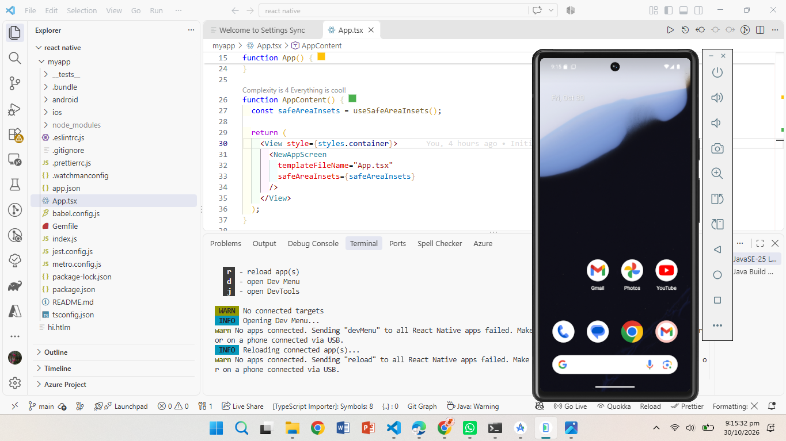
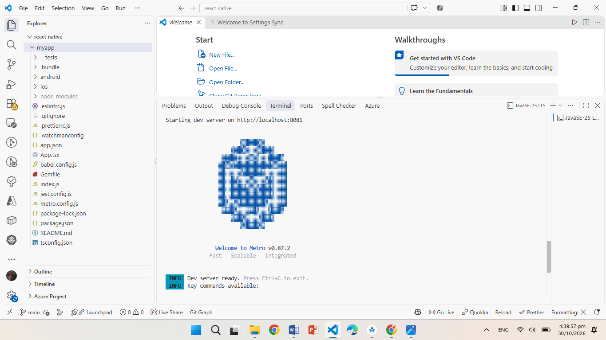

# React Native Setup - MAD Assignment 1

**Student Name:** Mahnoor Yasir F2023266580

**Subject:** Mobile Application Development (MAD) V1

**University:** University of Management and Technology (UMT)

## Project Description

This project was created as part of MAD Assignment 1 to set up and run a React Native application using an Android Emulator.

## Technologies Used

- React Native
- JavaScript / TypeScript
- Android Studio
- Visual Studio Code
- Git and GitHub

## Screenshots

### 1. Android Emulator

### 2. Project Structure

